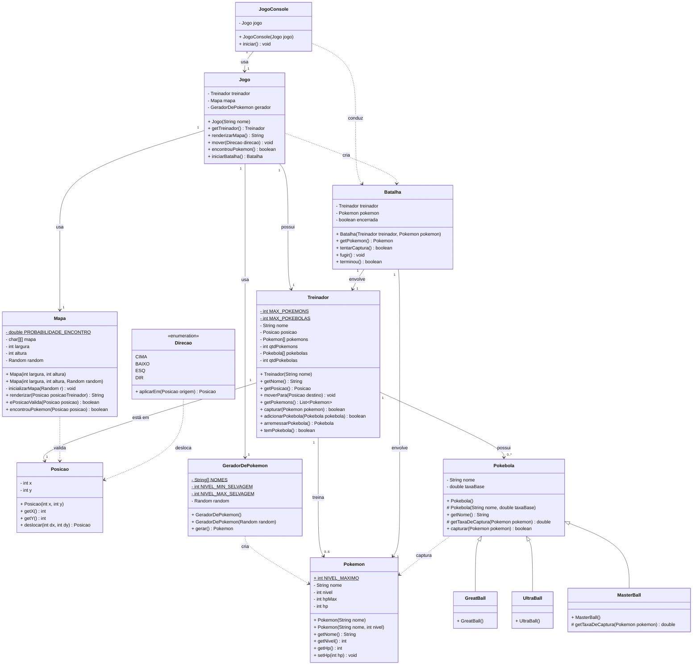
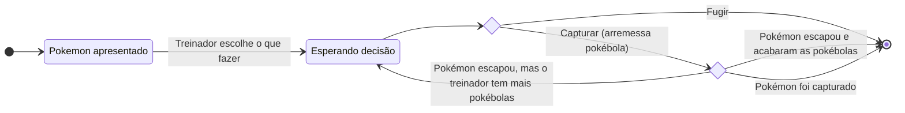

# Exercício: {{ page.title }}

## Objetivo

Implementar a funcionalidade de captura de Pokémon no jogo. A lógica de movimentação no mapa já está funcionando, e as classes Pokemon e GeradorDePokemon estão disponíveis. O ponto de partida é a tag `v0.2.1` do repositório. Sua tarefa é implementar as classes relacionadas às Pokébolas, que serão usadas pelo treinador para tentar capturar os Pokémon encontrados. Para isso, utilizaremos **Herança**, já que existem diversos tipos de Pokébolas.

## Descrição
 
Neste exercício você irá criar as classes `Batalha`, `Pokebola`, `GreatBall`, `UltraBall` e `MasterBall`. Além disso, será necessário alterar as classes `Mapa`, `Treinador`, `Jogo` e `JogoConsole`.

No diagrama abaixo, `#` indica um membro `protected` e membros sublinhados são `static`. As classes `Direcao`, `Posicao`, `Pokemon` e `GeradorDePokemon` já existem e não precisam ser alteradas.

**Mapa:**

  - Atributos:
    - random: o `Random` recebido no construtor passa a ser guardado, para também sortear os encontros. Assim, os testes continuam podendo fixar uma semente.
  - Métodos: 
    - encontrouPokemon: indica se o treinador encontrou um Pokémon na posição informada.
      - A cada movimento, há 50% de chance (`PROBABILIDADE_ENCONTRO`) de encontrar um Pokémon.
      - No entanto, um Pokémon só pode ser encontrado em posições com grama (`'w'`).
      - O método recebe uma `Posicao`, e não um `Treinador`: o pacote `mapa` não deve depender do pacote `pokemon`.
    
**Treinador:**

  - Atributos:
    - pokebolas: armazena as pokébolas do treinador, até `MAX_POKEBOLAS`.
  - Métodos:
    - adicionarPokebola: guarda uma pokébola, se houver espaço. Retorna `false` caso contrário.
    - arremessarPokebola: remove e devolve a pokébola que será utilizada na captura.
      - Uma pokébola só pode ser utilizada uma única vez. 
    - temPokebola: indica se o treinador ainda tem pokébolas.

**Jogo:**

  - Atributos:
    - gerador: o `GeradorDePokemon` usado para criar os Pokémon selvagens.
  - No construtor, crie o gerador e entregue ao treinador um conjunto inicial de pokébolas.
  - Métodos:
    - encontrouPokemon: pergunta ao mapa se há um Pokémon na posição atual do treinador.
    - iniciarBatalha: usa o gerador para criar um Pokémon selvagem e devolve uma nova `Batalha` entre ele e o treinador.

**GeradorDePokemon (já existe):**

  - Cria os Pokémon selvagens: sorteia um nome de uma lista fixa e um nível entre 1 e 30.
  - A faixa de níveis é limitada a 30 para que a diferença entre as pokébolas apareça no jogo: com níveis próximos de `Pokemon.NIVEL_MAXIMO`, a chance de captura de qualquer pokébola comum cai para perto de 5%.
  - Assim como `Mapa`, o gerador pode receber um `Random`. Com uma semente fixa, os Pokémon gerados são sempre os mesmos, o que permite escrever testes (veja `TesteGeradorDePokemon`).
   
**Batalha:**
  
  - Essa classe controla a interação entre Treinador e Pokemon, simulando uma batalha.
  - Na versão atual, existem duas opções: tentar capturar o Pokémon ou fugir.
  - Assim como `Jogo`, `Batalha` não lê do teclado nem imprime nada: quem mostra as opções e lê a escolha do usuário é `JogoConsole`.
  - Atributos:
    - treinador: o treinador em batalha.
    - pokemon: o Pokémon selvagem em batalha.
    - encerrada: indica se a batalha terminou.
  - Métodos:
    - tentarCaptura: arremessa uma pokébola do treinador no Pokémon. Se a captura der certo, o Pokémon passa a fazer parte da equipe do treinador. Retorna `true` se o Pokémon foi capturado.
    - fugir: encerra a batalha.
    - terminou: indica se a batalha terminou.

Fluxo de uma batalha:

**Pokebola:**

- Atributos:
  - nome: nome da Pokébola.
  - taxaBase: taxa base de captura (entre 0.0 e 1.0).

- Métodos:
  - Construtores:
    - `Pokebola()`: cria uma Pokébola comum (nome "Pokébola", taxa base = 0.4).
    - `Pokebola(String nome, double taxaBase)`: `protected`, usado pelas subclasses via `super(...)`.
  - getTaxaDeCaptura: para um dado Pokémon, calcula a chance de capturá-lo.
    - Utilize a seguinte fórmula:
      - $$ taxaBase - taxaBase \cdot \cfrac{nivelPokemon}{NIVEL\_MAXIMO} + 0.05 $$
      - `NIVEL_MAXIMO` é a constante `Pokemon.NIVEL_MAXIMO` (100).
  - capturar: sorteia um número aleatório entre 0 e 1. Se ele for **menor** que a chance de captura, o Pokémon é capturado.
    - Retorne `true` se a captura for bem-sucedida, `false` caso contrário.
 
 
**Classes Derivadas de Pokebola:**

 - Crie as seguintes subclasses de Pokebola:
   - Great Ball: taxa base = 0.6.
   - Ultra Ball: taxa base = 0.8.
   - Master Ball: taxa base = 1.0, mas sempre captura. Para isso, sobrescreva `getTaxaDeCaptura`.
